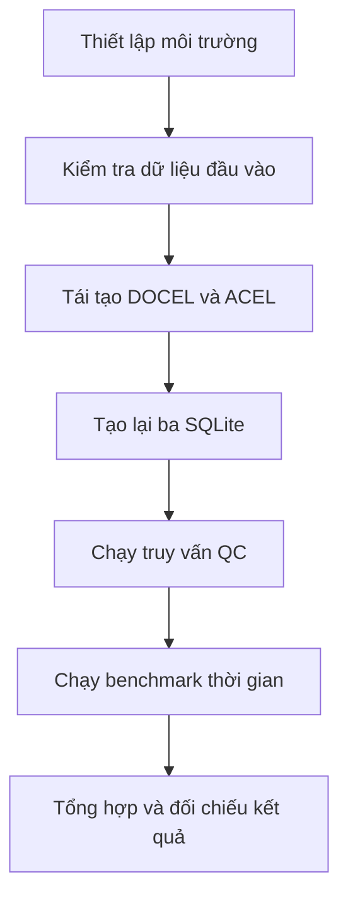

# TÁI HIỆN THỰC NGHIỆM DIRIGO VÀ ĐỀ XUẤT TỰ ĐỘNG HÓA PIPELINE DIRIGO-INVENTORY

> Trạng thái tài liệu: bản mô tả dự án và khung báo cáo thực nghiệm có thể tiếp tục cập nhật khi hoàn thành benchmark thời gian.

## 1. Tóm tắt dự án

Dự án gồm hai phần liên tiếp:

1. **Tái hiện thực nghiệm của Dirigo** trên dữ liệu mô phỏng quy trình lấy hàng tại cảng, bao gồm kiểm tra dữ liệu nguồn, tái tạo ACEL/DOCEL từ schema Dirigo, tạo lại cơ sở dữ liệu SQLite và đánh giá các schema theo các tiêu chí chất lượng QC1-QC4.
2. **Mở rộng Dirigo thành pipeline tự động hóa cho dữ liệu quản lý tồn kho**, trong đó người dùng mô tả ánh xạ bằng YAML; hệ thống đọc cơ sở dữ liệu nguồn, chuyển ánh xạ sang Intermediate Representation (IR), dùng các builder để tạo bảng Dirigo và OCEL 2.0, sau đó kiểm tra bằng bộ validator tùy chỉnh và PM4Py.

Phần mở rộng không thay đổi phương pháp phân tích nghiệp vụ năm bước của Dirigo. Mục tiêu là bổ sung lớp công cụ để biến kết quả phân tích nghiệp vụ thành một pipeline có thể cấu hình, chạy lại và kiểm thử.

---

## 2. Cơ sở nghiên cứu: phương pháp Dirigo

Dirigo là phương pháp trích xuất event log cho quy trình hướng đối tượng. Phương pháp được thiết kế theo ba nguyên tắc:

- **Conceptualisation principle**: mô hình hóa ở mức khái niệm, độc lập với hệ quản trị dữ liệu và công cụ cụ thể.
- **100% principle**: thu thập đầy đủ thông tin cần thiết để sinh OCEL.
- **Generic principle**: có khả năng áp dụng cho nhiều miền nghiệp vụ.

Dirigo thực hiện phân tích theo năm bước:

| Bước | Nội dung | Sản phẩm đầu ra |
|---|---|---|
| 1 | Xác định mục tiêu nghiệp vụ | Phạm vi và câu hỏi phân tích |
| 2 | Xác định các hoạt động | Danh sách event type/activity |
| 3 | Xác định object và thuộc tính | Object type, thuộc tính tĩnh và động |
| 4 | Xác định quan hệ Event-to-Object | E2O và qualifier |
| 5 | Xác định quan hệ Object-to-Object | O2O tĩnh/động và qualifier |

### 2.1. Các tiêu chí chất lượng

| Mã | Tiêu chí |
|---|---|
| QC1 | Các bảng quan hệ tuân thủ tối thiểu chuẩn 3NF |
| QC2.a | Không mất thuộc tính tĩnh của object |
| QC2.b | Không mất thuộc tính động của object |
| QC2.c | Không mất thuộc tính event |
| QC3.a | Không mất quan hệ O2O tĩnh |
| QC3.b | Không mất quan hệ O2O động |
| QC3.c | Không mất quan hệ E2O |
| QC4.a | Không mất qualifier của O2O |
| QC4.b | Không mất qualifier của E2O |

### 2.2. Giới hạn của nghiên cứu làm cơ sở cho phần mở rộng

Bài báo đã cung cấp **way of working** và **way of modelling**, nhưng để lại các khoảng trống sau:

1. Chưa cung cấp cách tự động tạo object-centric log ở instance level từ dữ liệu nguồn.
2. Phần **way of supporting**, tức công cụ hỗ trợ thực thi phương pháp, nằm ngoài phạm vi nghiên cứu.
3. Việc lựa chọn bảng, join, khóa định danh, event, object, E2O, O2O và qualifier vẫn cần thực hiện thủ công.
4. Mã thực nghiệm phụ thuộc vào đường dẫn, notebook và cấu trúc dữ liệu cụ thể của use case.
5. Chưa có lớp cấu hình trung gian để tái sử dụng phương pháp cho một dataset mới.
6. Future work của bài báo tập trung vào object-centric process analytics, nhưng trước khi phân tích cần có một pipeline trích xuất đáng tin cậy, có thể kiểm tra và chạy lại.

Từ đó, phần mở rộng của dự án đặt câu hỏi:

> Có thể chuyển kết quả phân tích năm bước của Dirigo thành cấu hình máy đọc được, từ đó tự động sinh schema Dirigo và OCEL 2.0 cho một cơ sở dữ liệu quan hệ mới hay không?

---

## 3. Phần I - Tái hiện thực nghiệm Dirigo

### 3.1. Mục tiêu

- Thiết lập lại môi trường của repository `Dirigo_OCEL`.
- Kiểm tra dữ liệu đầu vào.
- Chạy lại phép chuyển đổi Dirigo sang DOCEL và ACEL.
- Tạo lại ba cơ sở dữ liệu SQLite.
- Kiểm tra QC2.a-QC4.b trên Dirigo, ACEL và DOCEL.
- Chạy benchmark thời gian trong `Database_Queries` và báo cáo trung bình, độ lệch chuẩn.

### 3.2. Quy trình tái hiện



### 3.3. Môi trường chạy

```powershell
python -m venv .venv
.\.venv\Scripts\Activate.ps1
python -m pip install --upgrade pip
python -m pip install -r requirements.txt
```

Các notebook trong `Database_Processing` cần dùng một biến `ROOT` thống nhất thay vì đường dẫn tuyệt đối:

```python
from pathlib import Path

ROOT = Path.cwd().resolve()
```

Ví dụ đọc file:

```python
events = pd.read_csv(ROOT / "Dirigo" / "OCEL_Events.csv")
```

### 3.4. Kiểm tra dữ liệu đầu vào

| Bảng/file | Số bản ghi quan sát được |
|---|---:|
| `OCEL_Events` | 1.500 |
| `OCEL_E2O` | 1.600 |
| `OCEL_O2O` | 500 |
| `OCEL_Truck` | 1.450 |
| `OCEL_Cargo` | 120 |
| `OCEL_PickupPlan` | 100 |

Các số lượng này được dùng làm mốc kiểm tra cho các notebook chuyển đổi và truy vấn QC.

### 3.5. Kết quả tái tạo schema

| Thực nghiệm | Kết quả | Kết luận |
|---|---|---|
| Dirigo -> DOCEL | Các file tái tạo khớp baseline về danh sách file, cột, số dòng và nội dung; 12/12 file PASS | Tái tạo thành công |
| Dirigo -> ACEL | Các file tái tạo khớp baseline; 3/3 file PASS | Tái tạo thành công |
| CSV -> SQLite | Tạo được ba database tương ứng Dirigo, ACEL và DOCEL | Thành công về mặt sinh file; cần bổ sung kiểm tra toàn vẹn |

Phép so sánh baseline sử dụng `dtype=str` và `keep_default_na=False` để tránh khác biệt giả do suy luận kiểu dữ liệu hoặc cách biểu diễn giá trị rỗng.

### 3.6. Kết quả QC quan sát được

| Tiêu chí | Dirigo | ACEL | DOCEL | Ghi chú |
|---|:---:|:---:|:---:|---|
| QC1 | Chưa đo bằng test | Chưa đo bằng test | Chưa đo bằng test | Báo cáo mới nêu đánh giá cấu trúc; cần kiểm tra 3NF có hệ thống |
| QC2.a | PASS | PASS | PASS | Thuộc tính tĩnh Truck/Cargo đầy đủ |
| QC2.b | PASS | FAIL | FAIL | ACEL và DOCEL thiếu lịch sử của một số thuộc tính động |
| QC2.c | PASS | PASS | PASS | Đủ `event_id`, `activity`, `timestamp` cho 1.500 event |
| QC3.a | PASS | PASS | PASS | Quan sát được 100 liên kết O2O tĩnh |
| QC3.b | PASS | PASS | **FAIL** | Dirigo/ACEL có 400 bản ghi lịch sử; DOCEL chỉ có 200 và thiếu thao tác `Drop` |
| QC3.c | PASS | PASS | PASS | Quan sát được 1.600 cặp Event-Object |
| QC4.a | PASS | PASS | FAIL | DOCEL không lưu qualifier O2O |
| QC4.b | PASS | PASS | FAIL trong bản tái hiện | DOCEL không có qualifier E2O trong dữ liệu tái tạo |

### 3.7. Phát hiện quan trọng khi tái hiện

#### QC3.b của DOCEL

Bảng tổng kết cuối báo cáo đánh dấu DOCEL đạt QC3.b, nhưng phần phân tích chi tiết cho thấy:

- Kỳ vọng: 400 bản ghi lịch sử của quan hệ động.
- Quan sát: 200 bản ghi.
- Tất cả bản ghi là `Assign For Truck`.
- Không có thao tác `Drop`.

Vì vậy kết luận nhất quán với bằng chứng phải là **DOCEL FAIL QC3.b**.

#### QC4.b của DOCEL

Kết quả tái hiện cho thấy DOCEL không chứa qualifier E2O và được tính là 0%, trong khi bảng đánh giá của bài báo gốc đánh dấu DOCEL đạt QC4.b. Đây là sai khác cần được trình bày như một phát hiện tái hiện, không nên tự động sửa kết quả để khớp bài báo.

### 3.8. Những phần thực nghiệm chưa hoàn tất

1. **Benchmark thời gian chưa có kết quả số**: chưa báo cáo `mean`, `standard deviation`, số vòng lặp và cấu hình máy.
2. **QC1 chưa có test tái lập**: chưa có kiểm tra functional dependency, khóa và vi phạm chuẩn hóa.
3. **Chưa kiểm tra toàn vẹn sau CSV -> SQLite**: cần kiểm tra số dòng, khóa chính, khóa ngoại, duplicate và null bắt buộc.
4. **Chưa đo kích thước lưu trữ**: cần so sánh dung lượng ACEL, DOCEL và Dirigo.
5. **Chưa có round-trip test**: CSV -> SQLite -> DataFrame phải bảo toàn dữ liệu.
6. **Chưa ghi rõ phiên bản thư viện và cấu hình phần cứng**.

### 3.9. Các điểm cần sửa trong phương pháp kiểm tra

- Không loại giá trị `0` khi kiểm tra thuộc tính động; `0` có thể là giá trị nghiệp vụ hợp lệ.
- Không nên kết luận quan hệ tĩnh chỉ vì cặp object xuất hiện tại một timestamp. Cần xét semantic của qualifier và toàn bộ lifecycle.
- QC2.c không chỉ là ba trường bắt buộc. Cần kiểm tra cả các event attribute được xác định ở bước phân tích miền.
- Cần phân biệt **số relation duy nhất** và **số bản ghi lịch sử của relation**.
- Mọi tiêu chí phải chỉ rõ công thức, tập kỳ vọng, tập quan sát và điều kiện PASS/FAIL.

### 3.10. Kế hoạch chạy benchmark cuối

Các notebook processing-time cần chạy đủ 20 tập kết quả:

| Tiêu chí | Số schema được đo | Số kết quả `mean/std` |
|---|---:|---:|
| QC2.a | Dirigo, ACEL, DOCEL | 3 |
| QC2.b | Dirigo | 1 |
| QC2.c | Dirigo, ACEL, DOCEL | 3 |
| QC3.a | Dirigo, ACEL, DOCEL | 3 |
| QC3.b | Dirigo, ACEL, DOCEL | 3 |
| QC3.c | Dirigo, ACEL, DOCEL | 3 |
| QC4.a | Dirigo, ACEL | 2 |
| QC4.b | Dirigo, ACEL | 2 |
| **Tổng** |  | **20** |

Mỗi truy vấn cần ghi:

```text
schema, criterion, repetitions, mean_ms, std_ms,
min_ms, median_ms, max_ms, machine, Python version
```

---

## 15. Tài liệu tham khảo và nguồn dữ liệu

1. Wei, J. và cộng sự. *Dirigo: A Method to Extract Event Logs for Object-Centric Processes*. arXiv:2411.07490. <https://arxiv.org/abs/2411.07490>
2. Dirigo OCEL repository. <https://github.com/jennyVVei/Dirigo_OCEL>
3. OCEL 2.0 Specification. <https://www.ocel-standard.org/>
4. Inventory Management Database and OCELs. <https://www.ocel-standard.org/event-logs/simulations/invent_manag/>
5. Zenodo dataset DOI: <https://doi.org/10.5281/zenodo.21977737>
6. PM4Py documentation. <https://processintelligence.solutions/pm4py>

